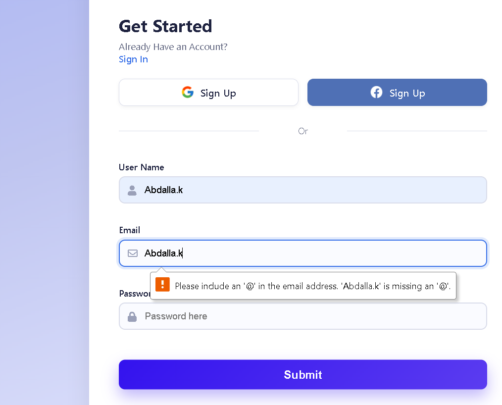

# Facebook Login

A sign-up form with client-side validation. Each field is checked when the form is submitted, shows an error message if it's empty, and gets a green or red border with a status icon. When all fields are valid, a success popup appears.

## Screenshots

### Valid fields


### Empty form with errors


## Features

- Validates username, email, and password on submit
- Red border, error message, and warning icon for empty fields
- Green border and check icon for valid fields
- Success popup when every field is valid, and the form resets after closing it
- Responsive layout: side-by-side on desktop, stacked on tablets and phones

## How to Run

1. Clone the repository:
   ```bash
   git clone https://github.com/abdallaahemd/Facebook-Login.git
   ```
2. Open the project folder.
3. Open `index.html` in your browser.

## Project Structure

```
Facebook-Login/
├── index.html      # Page layout and form
├── style.css       # Styles
├── main.js         # Validation and popup logic
├── images/         # Logo and illustration
└── screenshots/    # Screenshots used in this README
```

## What I Learned

- Listening to the `submit` event and stopping the default page reload with `preventDefault()`
- Checking input values with `trim()`
- Showing and hiding icons and messages by changing styles from JavaScript
- Using `every()` to check that all fields are valid
- Building a reusable popup with `createElement` and `innerHTML`

## Built With

- HTML
- CSS
- JavaScript
- Font Awesome

## Author

**Abdallah Ahmed**: Programming instructor and developer
- LinkedIn: https://www.linkedin.com/in/abdalla-konsowa-386414203
- itch.io: https://abdallak.itch.io/
